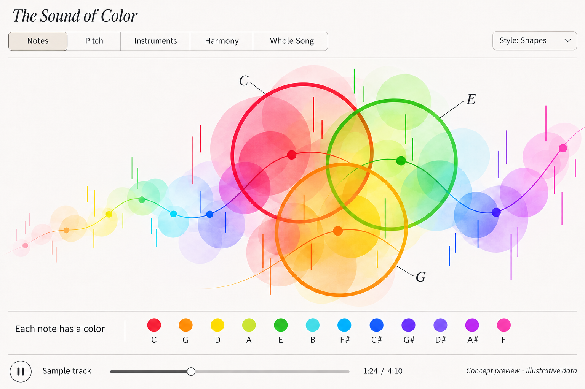
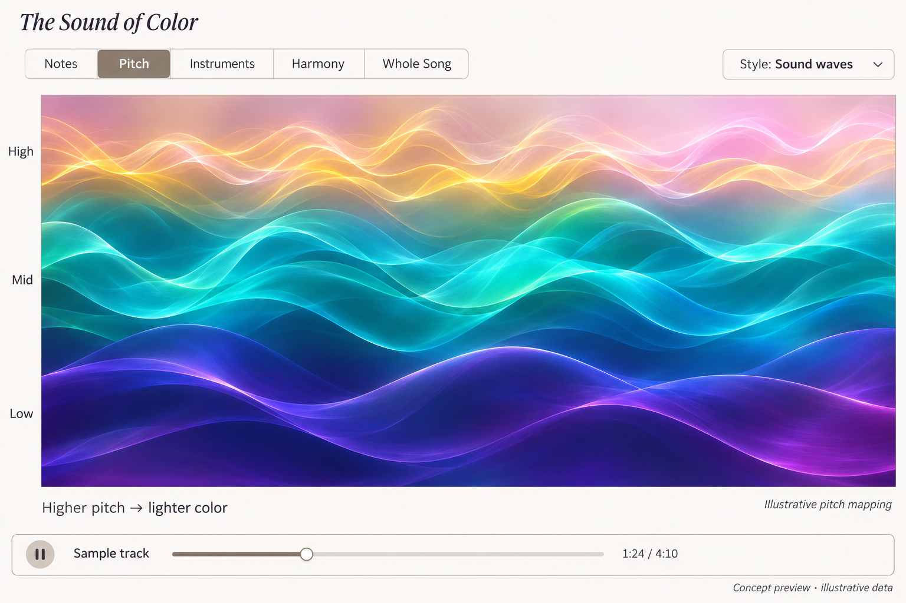
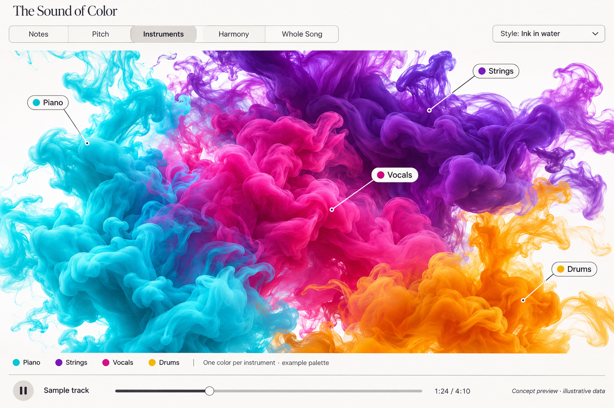
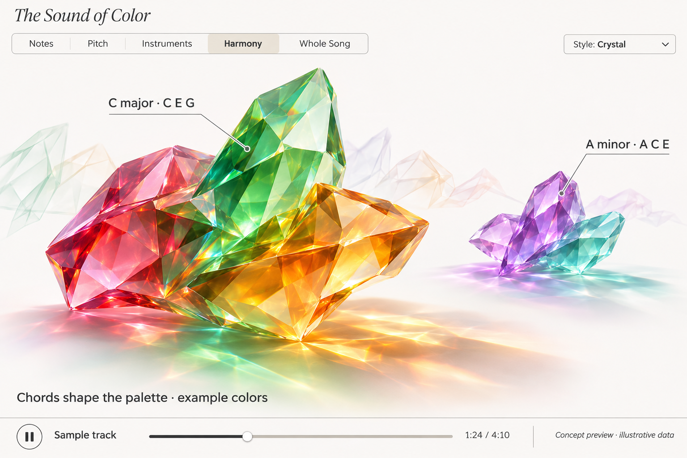
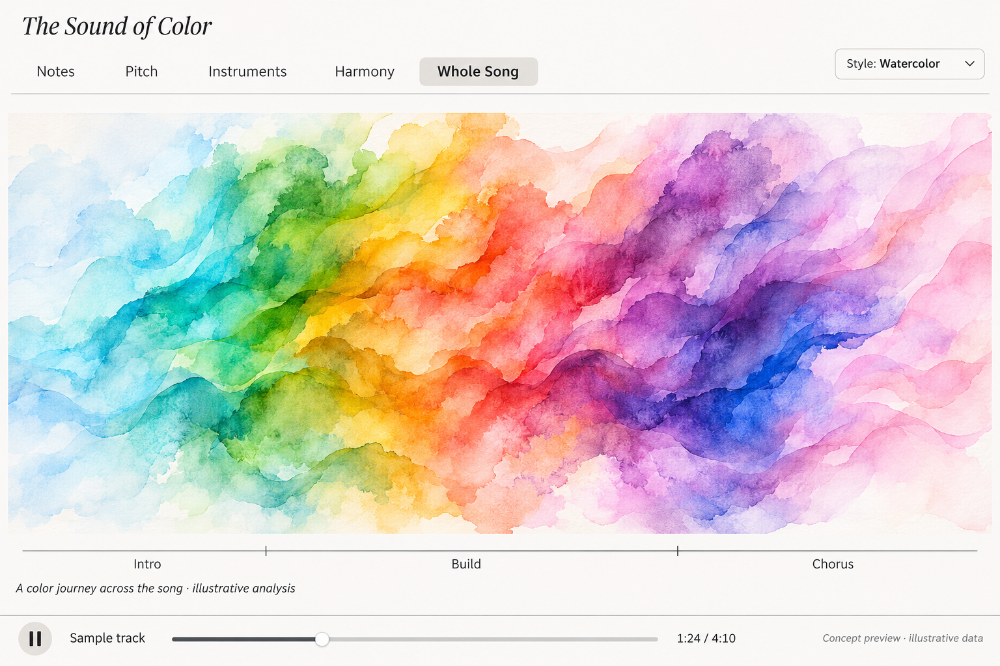

# Five ways to see the music

These are generated concept screenshots with illustrative musical input. They show proposed trigger views, not implemented app screens. The colors are examples rather than a universal mapping for synesthesia.

## Notes

Each detected note creates its own colored mark. The example shows a C–E–G chord as three colors.

## Pitch

Higher and lower sounds occupy different heights and brightness levels. Sound waves are a proposed new visual style.

## Instruments

Different instrument parts have separate colors and layered ink plumes. The example instrument labels are illustrative. Reliable instrument parts require additional analysis or separate instrument recordings.

## Harmony

Chord groups become crystal formations. Detecting several frequency peaks in the current app does not establish the chord or key. This view needs a dedicated harmony analysis step.

## Whole Song

A watercolor composition shows changes across sections of a song. The proposed goal is one finished still painting when the song ends. Musical events add to and develop that composition over time, and the completed work can be saved. This requires deliberate preservation of earlier marks, a completion state, and tracking musical features across the song. The current app has accumulating styles, but several styles fade or redraw earlier marks and it has no dedicated whole-song interpretation.

## Which styles fit the views?

This table is a design recommendation for how styles could communicate each trigger after the views are implemented.

**Strong** means the style makes the distinction easy to see. **Possible** means it can work with additional visual encoding.

| Style | Notes | Pitch | Instruments | Harmony | Whole Song |
| --- | --- | --- | --- | --- | --- |
| Watercolor | Possible | Possible | Strong | Possible | Strong |
| Oil impasto | Possible | Possible | Strong | Possible | Strong |
| Shapes | Strong | Strong | Strong | Strong | Possible |
| Crystal | Strong | Possible | Possible | Strong | Possible |
| Ink in water | Possible | Possible | Strong | Possible | Strong |
| Aurora | Possible | Strong | Possible | Possible | Strong |
| Ink brush | Possible | Possible | Strong | Possible | Strong |
| Pointillism | Strong | Strong | Possible | Possible | Strong |
| Crystal cave | Strong | Possible | Possible | Strong | Possible |
| Sound waves — proposed | Possible | Strong | Strong | Possible | Strong |

For instrument views, separating colors into lanes or layers would keep mixed colors identifiable. For harmony, a group of marks or facets would represent one chord. The renderer alone does not identify instruments or chords.

## What the app supports today

The app currently estimates notes from frequency peaks and measures sound energy, bass, brightness and sudden changes. Those signals already influence the nine existing painting styles. These five views are proposed ways to organize and extend that information, not five currently available analysis modes.

Instrument identification, chord and key recognition, and whole-song section interpretation need additional implementation. The app has no Sound waves renderer yet.

Generated with the built-in ImageGen tool. The exact prompts for all five images are saved in generation-prompts.json.

## Updated direction — a painting made by a song

The user proposed one still painting at the end of each song. The five triggers describe which musical information contributes to the same evolving artwork. The visual style chooses how those contributions are painted. Playback would show the artwork forming, then completion would preserve a still piece for export. This is a proposed product direction. The concept screenshots illustrate possible visual grammar and are not proof that the app currently preserves a complete song painting.
